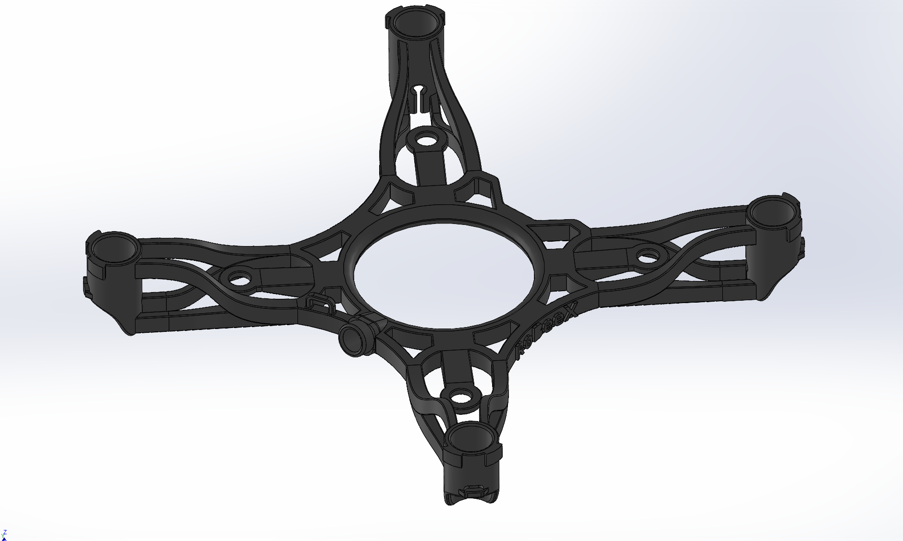
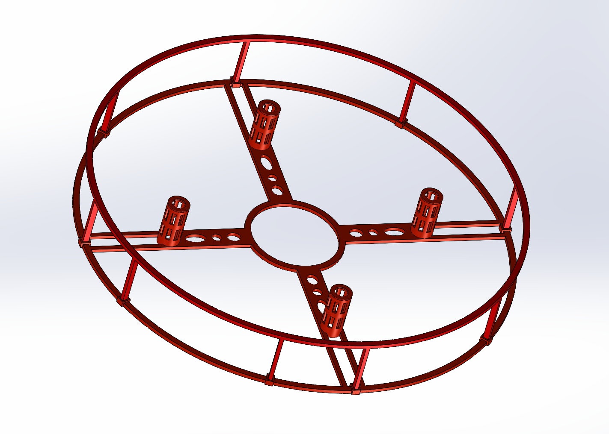
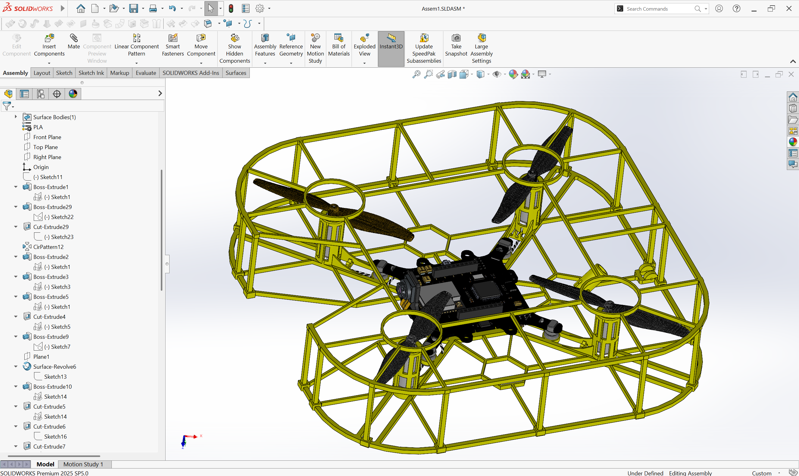
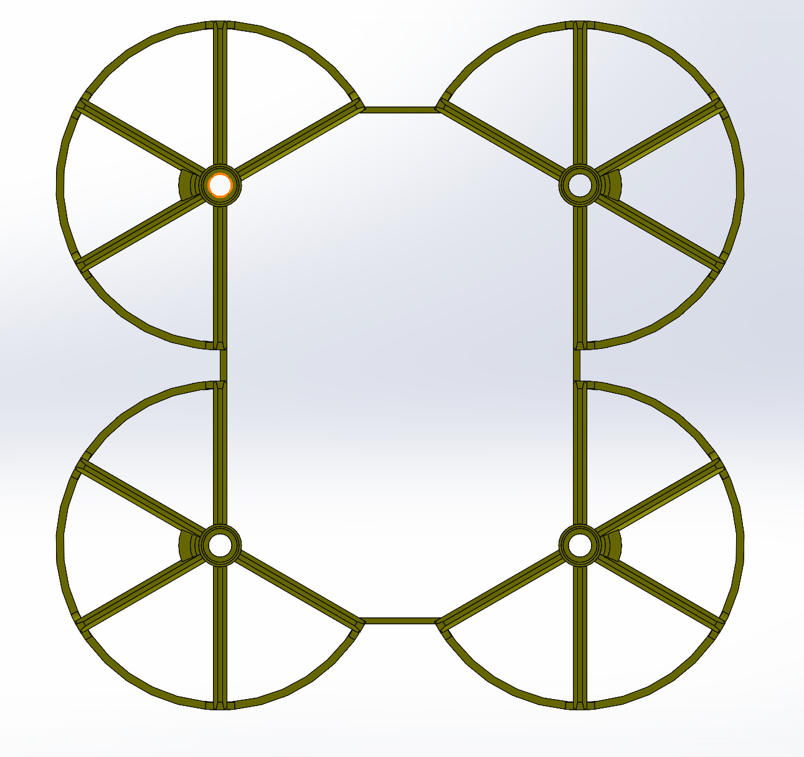

# RoBeeX 3D Designs

[English](#english) · [فارسی](#فارسی) · [العربية](#العربية)

## English

Custom frames and a propeller guard for RoBeeX drones. Download the SolidWorks files to adapt the designs to your needs, or use the STEP files to prepare your parts for 3D printing.

### Available designs

| Design | SolidWorks | STEP | Images |
| --- | --- | --- | --- |
| Open frame | [Source files](frames/frame-01-open/cad/) | [STEP](frames/frame-01-open/step/) | [Gallery](frames/frame-01-open/images/) |
| Circular frame | [Parts and assembly](frames/frame-02-circular/cad/) | [Top and bottom](frames/frame-02-circular/step/) | [Gallery](frames/frame-02-circular/images/) |
| Square frame, V2 | [Source files](frames/frame-03-square-v2/cad/) | [Top and bottom](frames/frame-03-square-v2/step/) | [Gallery](frames/frame-03-square-v2/images/) |
| Propeller guard | [Source file](propeller-guard/cad/) | [STEP](propeller-guard/step/) | [Gallery](propeller-guard/images/) |

| Open frame | Circular frame |
| :---: | :---: |
|  |  |
| Square frame V2 | Propeller guard |
|  |  |

### Working with the files

Each design includes SolidWorks files in `cad/`, STEP files in `step/`, and reference images in `images/`. Use the SolidWorks files to change dimensions or modify the design. To print a part, open its STEP file in a compatible slicer, or export STL or 3MF from your CAD software, then prepare the print for your printer.

For the circular frame, keep the assembly and its two part files together in the `cad/` folder and open `robeex-frame-02-circular.SLDASM`.

**Open frame:** the current STEP file is empty. Use the SolidWorks source to export a new STEP file before printing.

### Printing notes

Choose your material carefully and adjust the support type, layer height, and filament settings to suit your printer and the filament's brand and model.

Motor openings may come out tighter or looser than expected. You can adjust their dimensions in SolidWorks to get the right fit for your printer and filament.

We use a **Creality Ender-3 V3 Plus**, and the filament we have tested is **eSUN PLA+**.

If you need greater strength, consider carbon-fiber-filled filaments such as **PLA-CF** or **PETG-CF**, or **PA6-CF** for more demanding applications. The best choice depends on your equipment and the properties you need, so test the finished parts with your own setup.

Expect to make several trial prints. Calibrate your printer, adjust the settings, and test the fit and strength of the parts until you are happy with the result.

These designs are intended primarily for **education and research**. Printed parts may not be suitable for long-term use.

## فارسی

فریم‌ها و محافظ ملخ سفارشی برای پهپادهای RoBeeX. با فایل‌های سالیدورکس می‌توانید طرح‌ها را متناسب با نیاز خود تغییر دهید و با فایل‌های STEP قطعات را برای چاپ سه‌بعدی آماده کنید.

### طرح‌های موجود

- [فریم باز](frames/frame-01-open/)
- [فریم دایره‌ای](frames/frame-02-circular/)
- [فریم مربعی، نسخهٔ ۲](frames/frame-03-square-v2/)
- [محافظ ملخ](propeller-guard/)

### استفاده از فایل‌ها

در پوشهٔ هر طرح، فایل‌های سالیدورکس در `cad/`، فایل‌های STEP در `step/` و تصاویر مرجع در `images/` قرار دارند. برای تغییر ابعاد یا ویرایش طرح از فایل‌های سالیدورکس استفاده کنید. برای چاپ، فایل STEP را در اسلایسری که از این فرمت پشتیبانی می‌کند باز کنید، یا ابتدا از نرم‌افزار CAD خروجی STL یا 3MF بگیرید و سپس تنظیمات چاپ را برای پرینتر خود آماده کنید.

برای باز کردن مونتاژ فریم دایره‌ای، فایل مونتاژ و دو فایل قطعه را کنار هم در پوشهٔ `cad/` نگه دارید و فایل `robeex-frame-02-circular.SLDASM` را باز کنید.

**فریم باز:** فایل STEP فعلی خالی است. پیش از چاپ، از فایل اصلی سالیدورکس یک خروجی STEP جدید بگیرید.

### نکات چاپ سه‌بعدی

به متریالی که استفاده می‌کنید توجه کنید و نوع ساپورت، ارتفاع لایه و تنظیمات فیلامنت را متناسب با پرینتر و برند و مدل فیلامنت تنظیم کنید.

ممکن است دهانهٔ موتورها پس از چاپ کمی تنگ یا گشاد باشد. می‌توانید ابعاد آن‌ها را در سالیدورکس تغییر دهید تا با فیلامنت و پرینتر شما به اندازهٔ مناسب برسند.

پرینتر مورد استفادهٔ ما **Creality Ender-3 V3 Plus** و فیلامنت تست‌شده **eSUN PLA+** است.

برای استحکام بیشتر می‌توانید فیلامنت‌های حاوی الیاف کربن مانند **PLA-CF** یا **PETG-CF** و برای کاربردهایی با نیازهای مکانیکی بالاتر، **PA6-CF** را در نظر بگیرید. انتخاب مناسب به تجهیزات و ویژگی‌های مورد نیاز شما بستگی دارد؛ بنابراین قطعات چاپ‌شده را با شرایط خودتان آزمایش کنید.

برای رسیدن به نتیجهٔ مناسب، چند بار چاپ آزمایشی انجام دهید. پرینتر را کالیبره کنید، تنظیمات را تغییر دهید و اندازه و استحکام قطعات را بررسی کنید تا به نتیجهٔ دلخواه برسید.

این طرح‌ها بیشتر جنبهٔ **آموزشی و تحقیقاتی** دارند و قطعات چاپ‌شده ممکن است برای استفادهٔ طولانی‌مدت مناسب نباشند.

## العربية

هياكل وواقٍ للمراوح بتصاميم مخصصة لطائرات RoBeeX دون طيار. يمكنك استخدام ملفات SolidWorks لتعديل التصاميم بما يناسب احتياجاتك، أو ملفات STEP لتحضير القطع للطباعة ثلاثية الأبعاد.

### التصاميم المتاحة

- [الهيكل المفتوح](frames/frame-01-open/)
- [الهيكل الدائري](frames/frame-02-circular/)
- [الهيكل المربع، الإصدار الثاني](frames/frame-03-square-v2/)
- [واقي المراوح](propeller-guard/)

### استخدام الملفات

يحتوي مجلد كل تصميم على ملفات SolidWorks في `cad/`، وملفات STEP في `step/`، وصور مرجعية في `images/`. استخدم ملفات SolidWorks لتغيير الأبعاد أو تعديل التصميم. للطباعة، افتح ملف STEP في برنامج تقطيع يدعم هذا التنسيق، أو صدّر النموذج أولًا بصيغة STL أو 3MF من برنامج CAD، ثم جهّز إعدادات الطباعة المناسبة لطابعتك.

لفتح تجميع الهيكل الدائري، أبقِ ملف التجميع وملفَي الأجزاء معًا في مجلد `cad/`، ثم افتح `robeex-frame-02-circular.SLDASM`.

**الهيكل المفتوح:** ملف STEP الحالي فارغ. صدّر ملف STEP جديدًا من ملف SolidWorks الأصلي قبل الطباعة.

### ملاحظات الطباعة

اختر المادة بعناية، واضبط نوع الدعامات وارتفاع الطبقة وإعدادات خيط الطباعة بما يناسب طابعتك والعلامة التجارية للخيط ونوعه.

قد تكون فتحات المحركات أضيق أو أوسع من المطلوب بعد الطباعة. يمكنك تعديل أبعادها في SolidWorks للحصول على المقاس المناسب لطابعتك والخيط المستخدم.

نستخدم طابعة **Creality Ender-3 V3 Plus**، وخيط الطباعة الذي اختبرناه هو **eSUN PLA+**.

إذا كنت بحاجة إلى متانة أعلى، يمكنك تجربة خيوط مدعمة بألياف الكربون مثل **PLA-CF** أو **PETG-CF**، أو **PA6-CF** للتطبيقات الأكثر تطلبًا. يعتمد الاختيار المناسب على معداتك والخصائص التي تحتاج إليها، لذا اختبر القطع المطبوعة في ظروف الاستخدام لديك.

قد تحتاج إلى عدة طبعات تجريبية للوصول إلى النتيجة المناسبة. عاير الطابعة، وعدّل الإعدادات، واختبر مقاسات القطع ومتانتها حتى تصل إلى النتيجة المطلوبة.

هذه التصاميم مخصصة أساسًا **للتعليم والبحث**، وقد لا تكون القطع المطبوعة مناسبة للاستخدام طويل الأمد.

