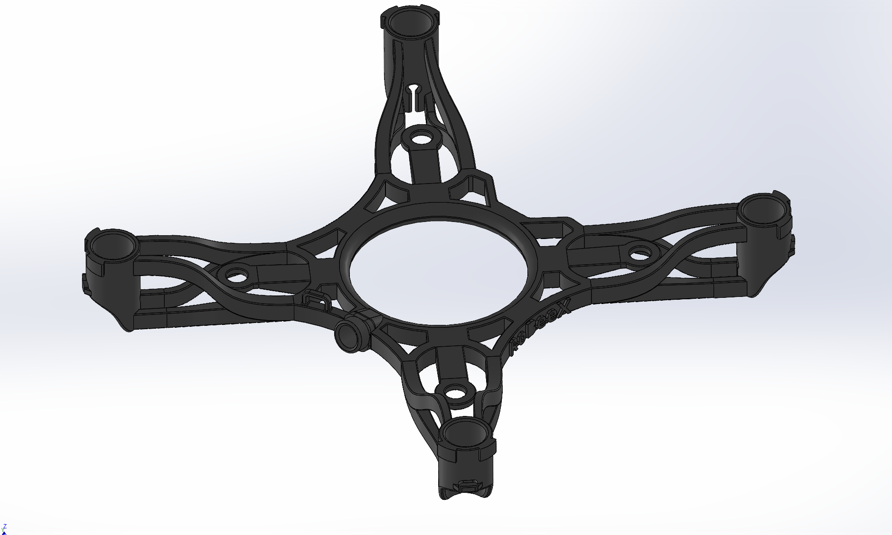
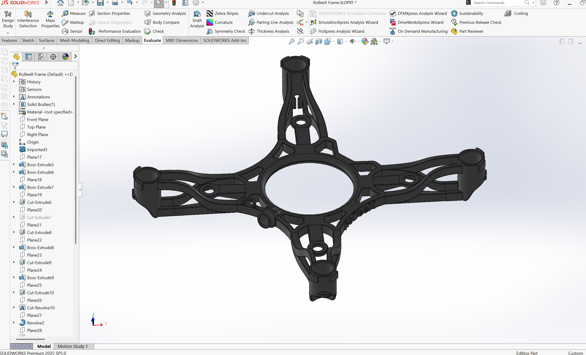

# Open Frame

An open frame design for RoBeeX drones, provided as an editable SolidWorks part.

[SolidWorks source](cad/) · [STEP file](step/) · [Gallery](images/) · [Printing notes](../../README.md#printing-notes)

**STEP export:** the current file contains no geometry. Export a new STEP file from the SolidWorks source before printing.

## Images

| View | View |
| :---: | :---: |
|  |  |
