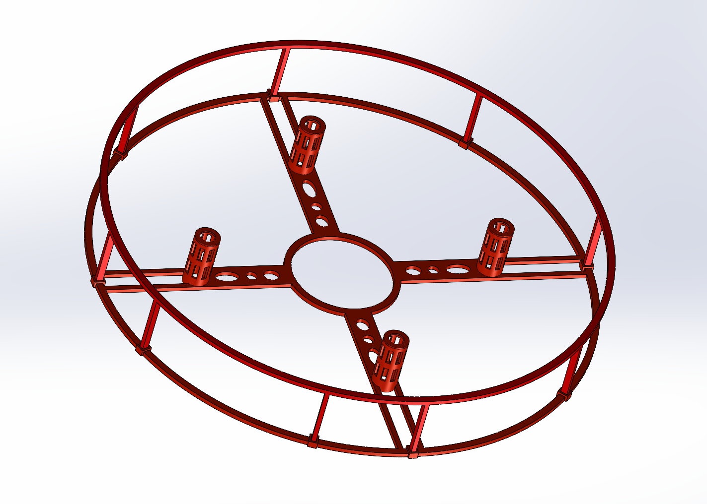
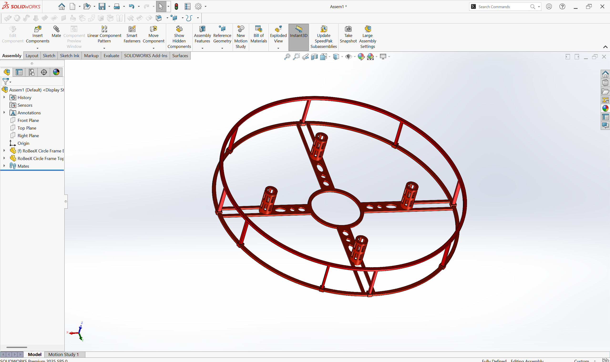
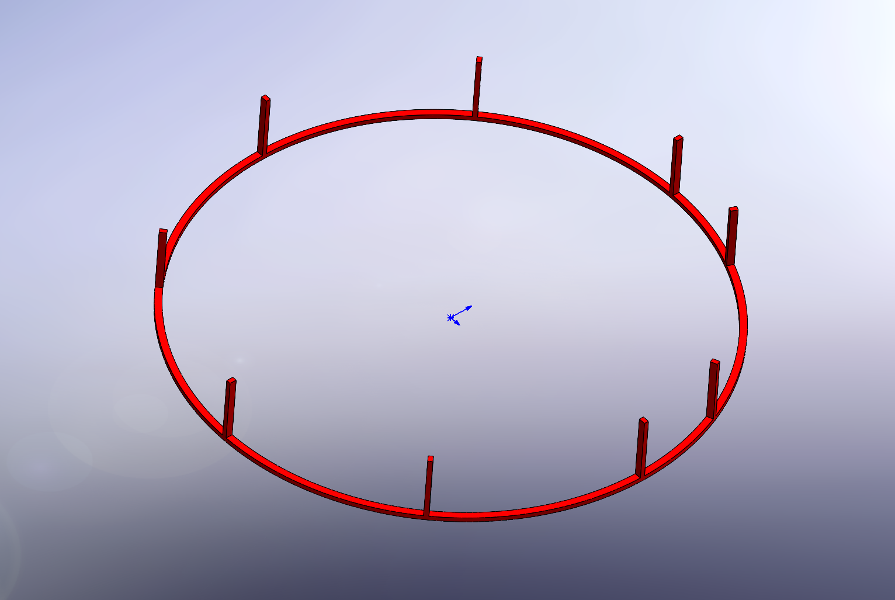
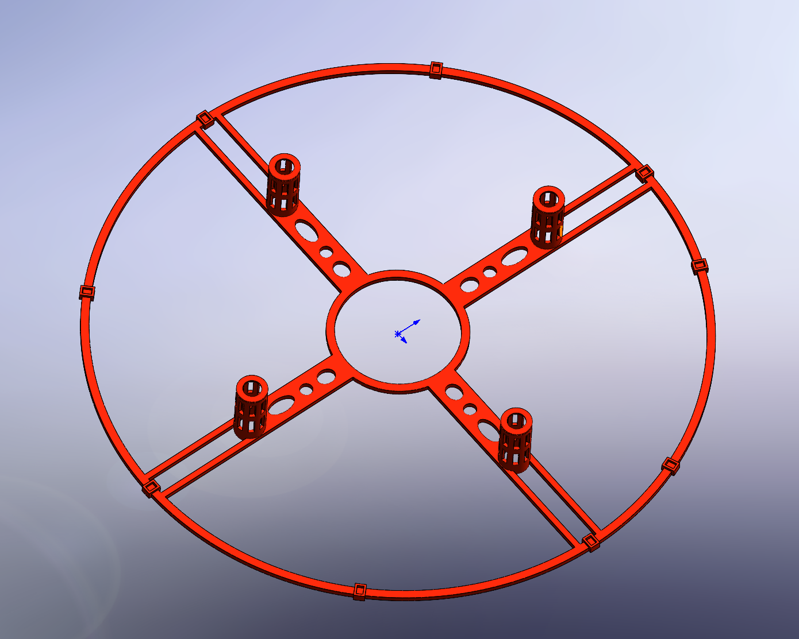

# Circular Frame

A circular frame for RoBeeX drones, with separate top and bottom parts and a SolidWorks assembly.

[SolidWorks parts and assembly](cad/) · [STEP files](step/) · [Gallery](images/) · [Printing notes](../../README.md#printing-notes)

Keep the assembly and both part files together in `cad/`, then open `robeex-frame-02-circular.SLDASM` in SolidWorks.

## Images

| View | View |
| :---: | :---: |
|  |  |
|  |  |
