# Square Frame V2

The second version of the square frame for RoBeeX drones, with separate top and bottom parts. SolidWorks sources and STEP exports are included for both parts.

[SolidWorks source](cad/) · [STEP files](step/) · [Gallery](images/) · [Printing notes](../../README.md#printing-notes)

## Images

| View | View |
| :---: | :---: |
| 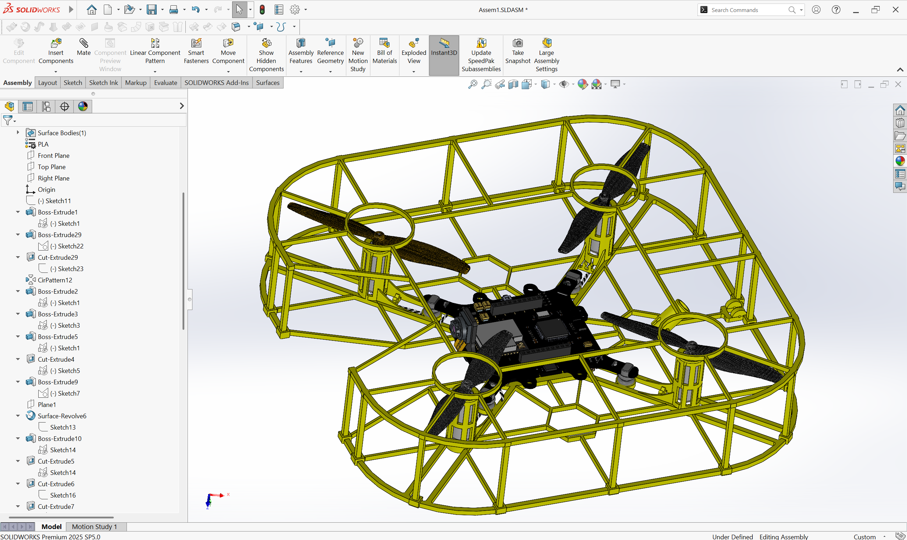 | 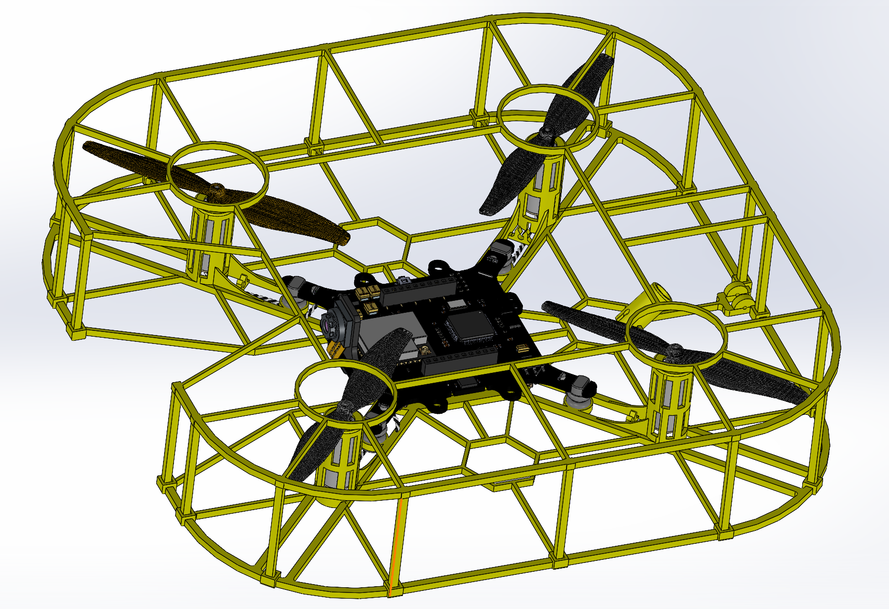 |
| 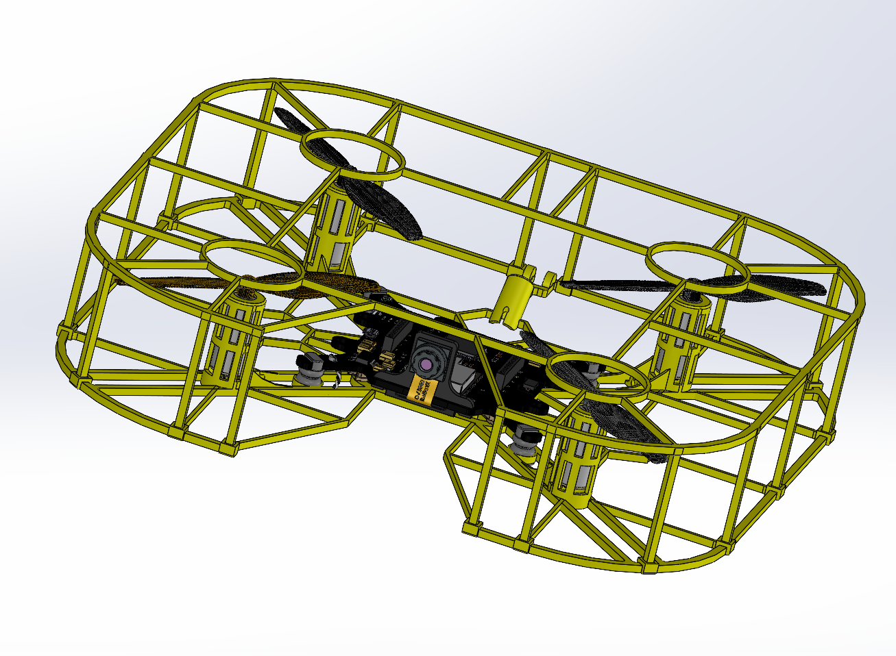 | 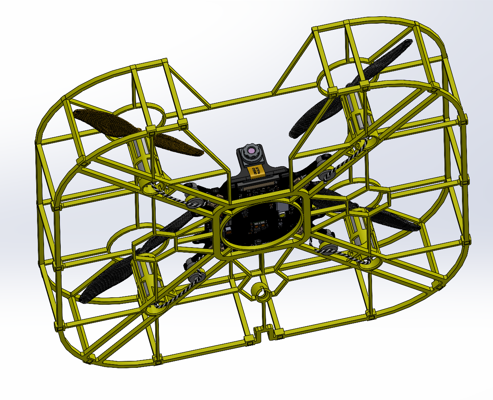 |
| 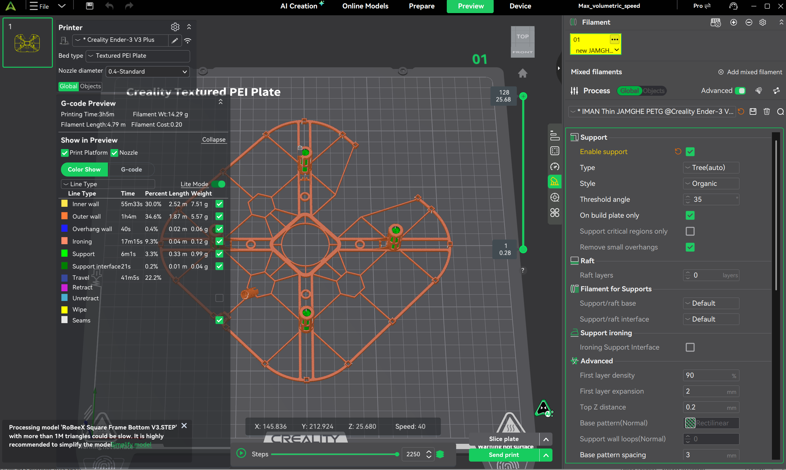 | 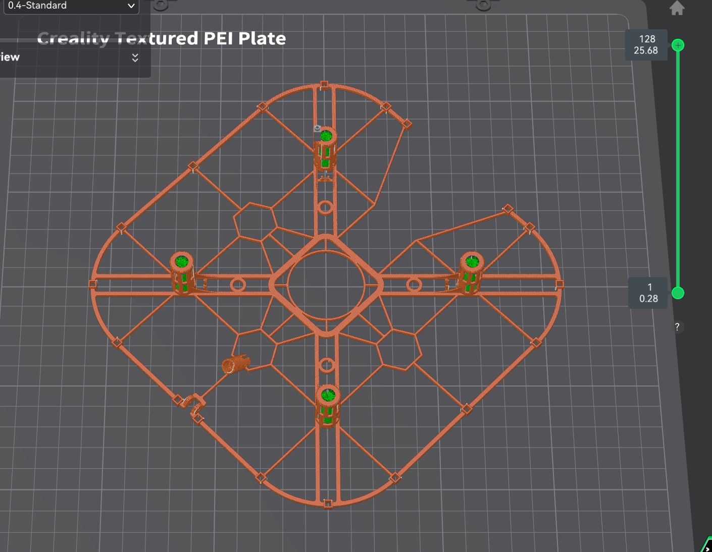 |
| 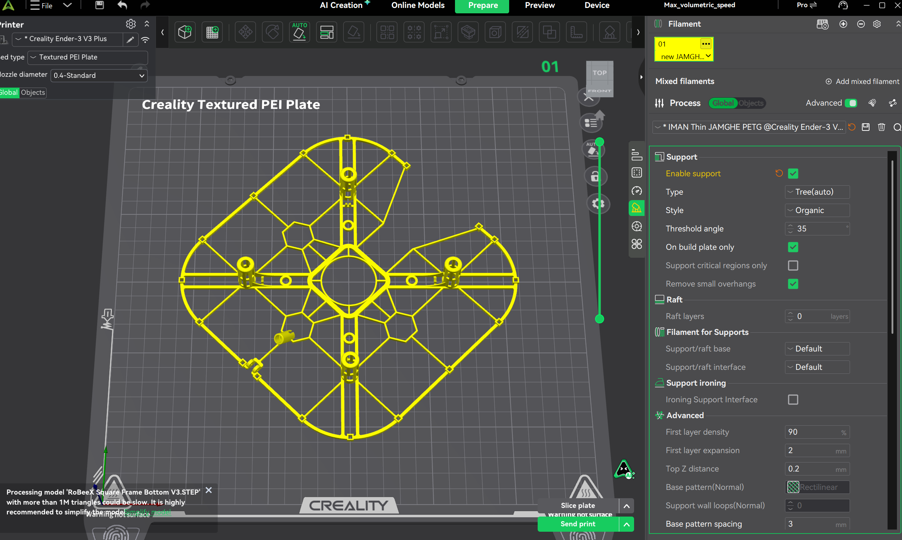 | 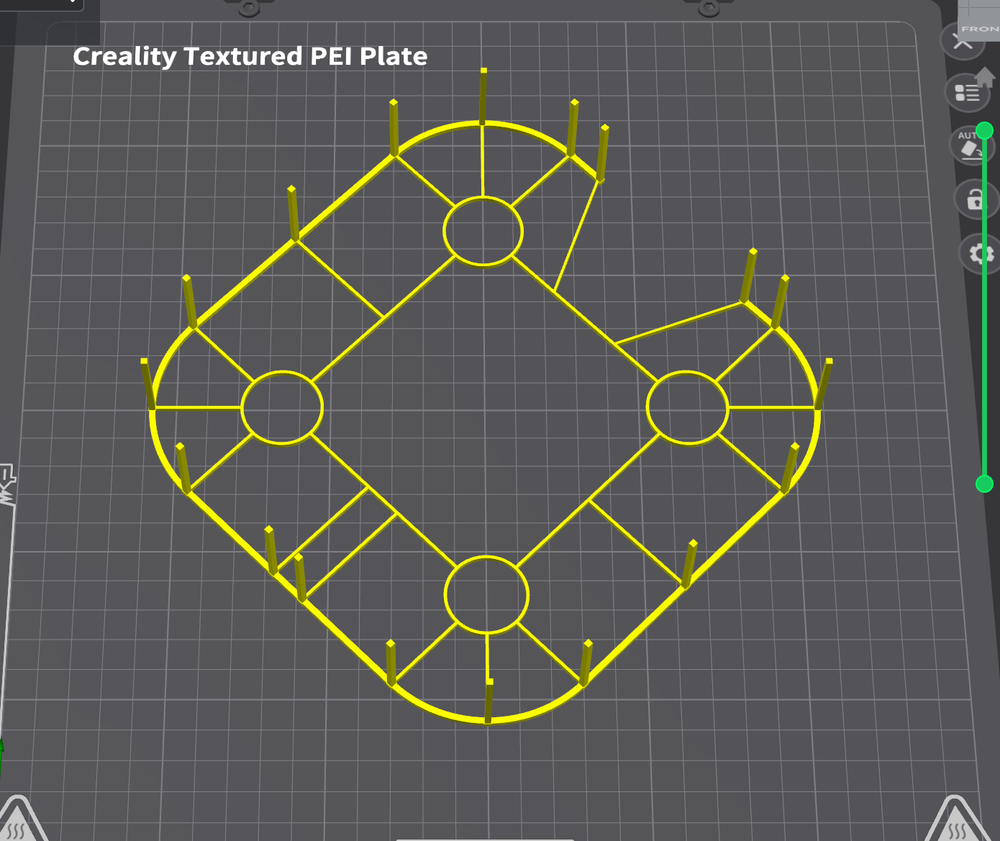 |
| 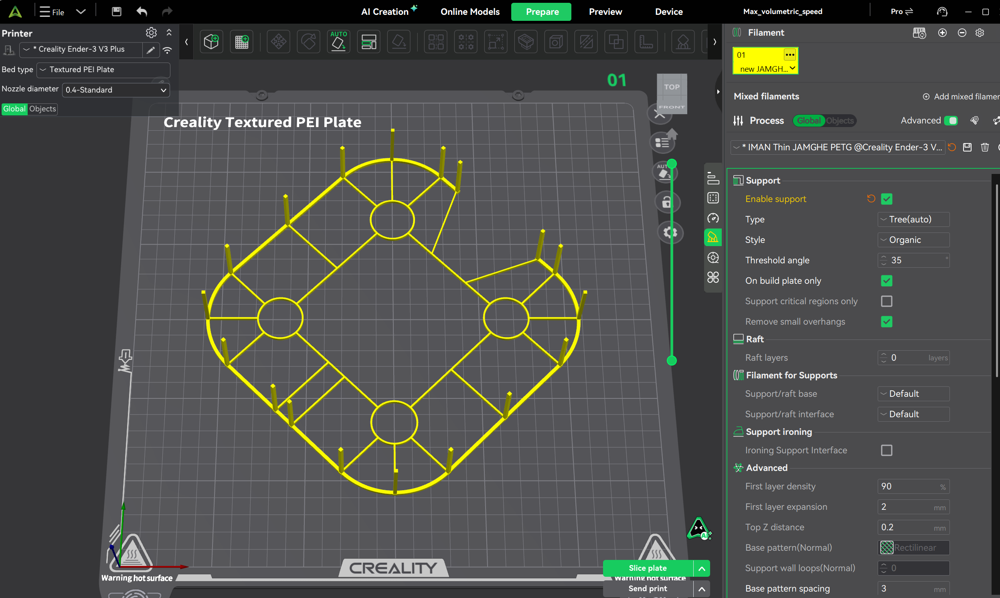 | 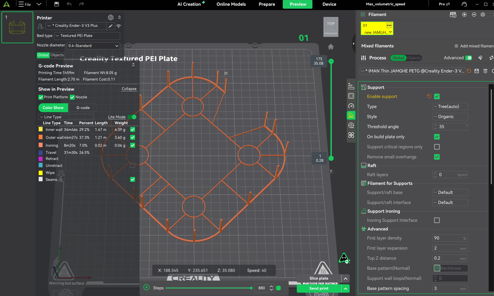 |
| 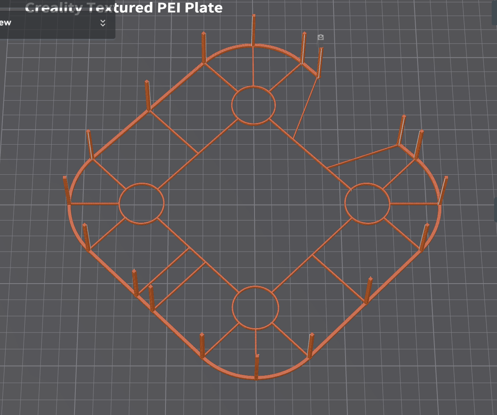 | 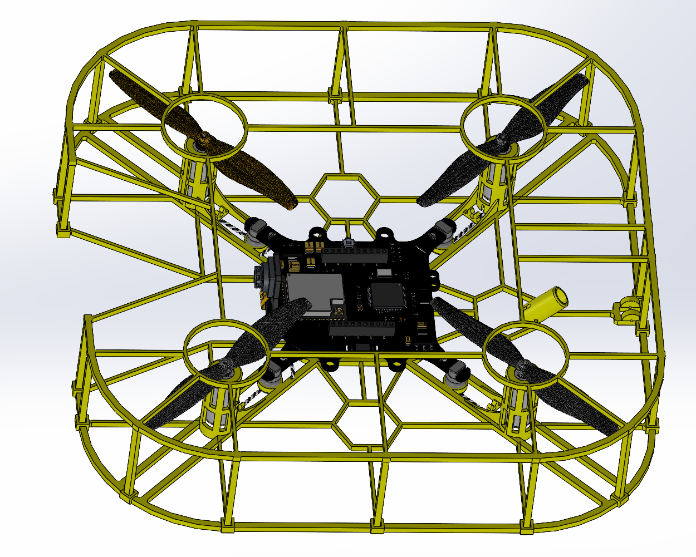 |
