# Propeller Guard

A propeller guard design for RoBeeX drones. Includes an editable SolidWorks part and a STEP export for preparing the part for 3D printing.

[SolidWorks source](cad/) · [STEP file](step/) · [Gallery](images/) · [Printing notes](../README.md#printing-notes)

## Images

| View | View |
| :---: | :---: |
| 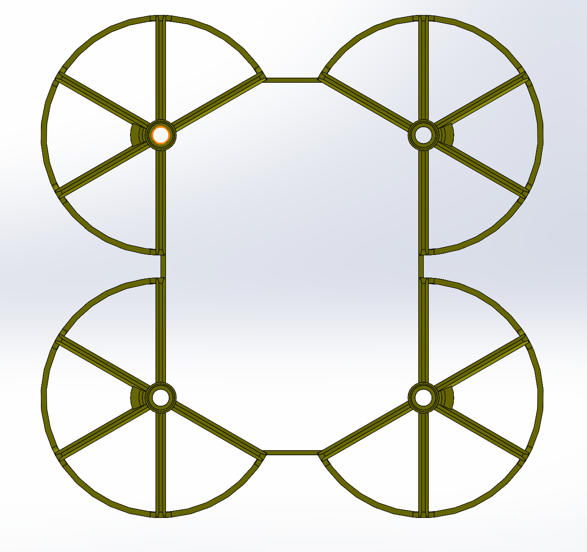 | 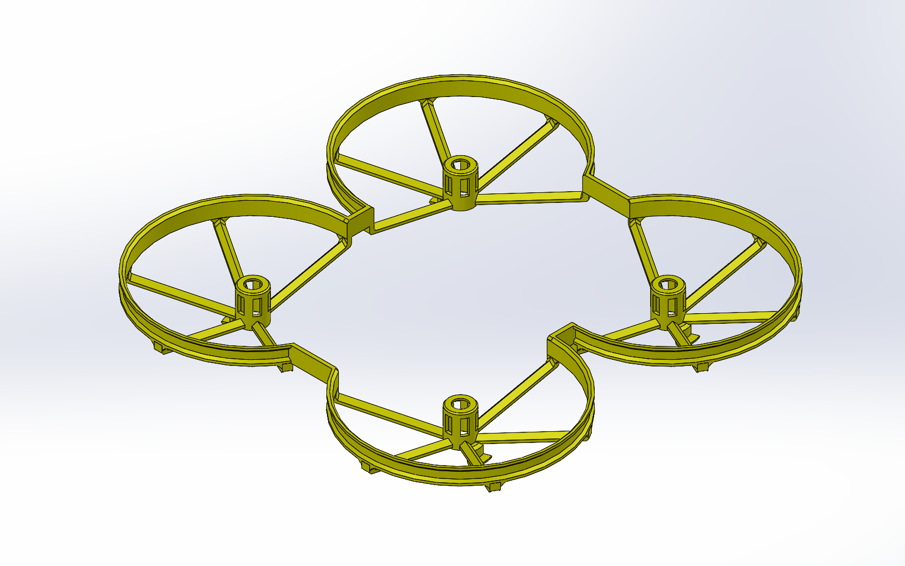 |
| 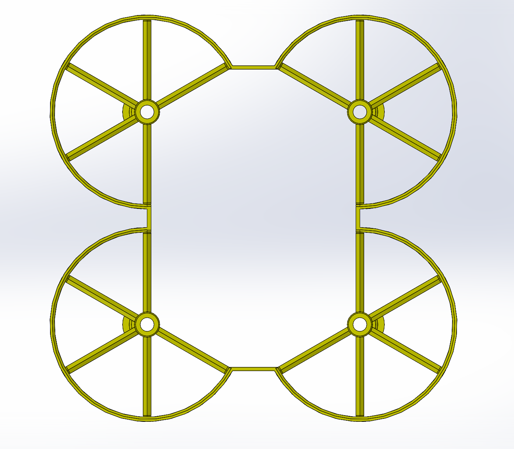 | 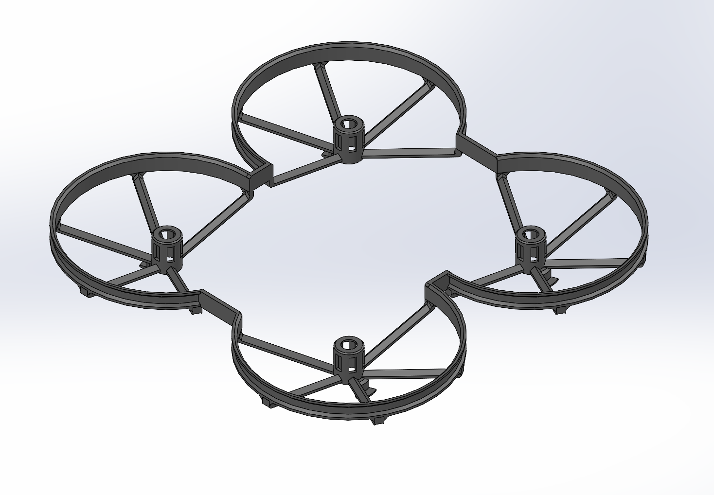 |
| 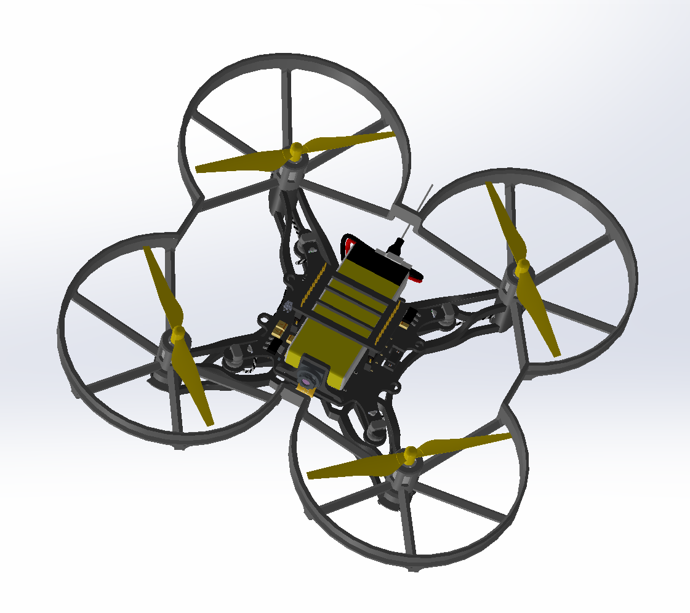 | 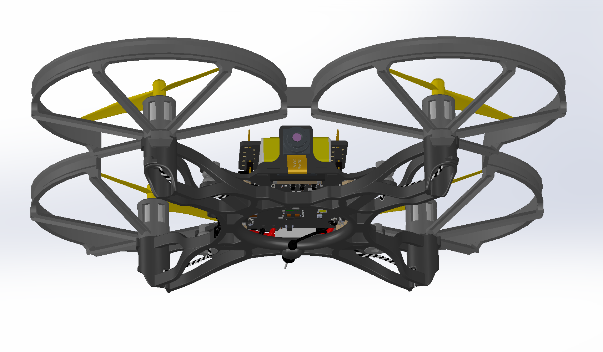 |
| 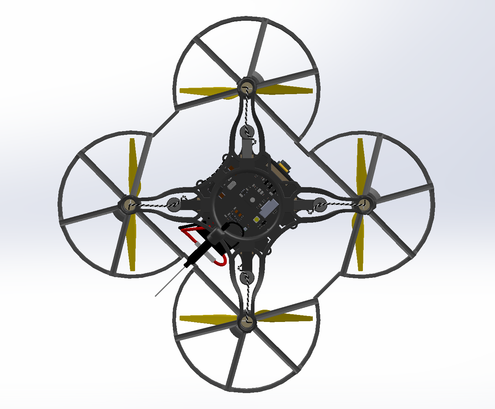 | 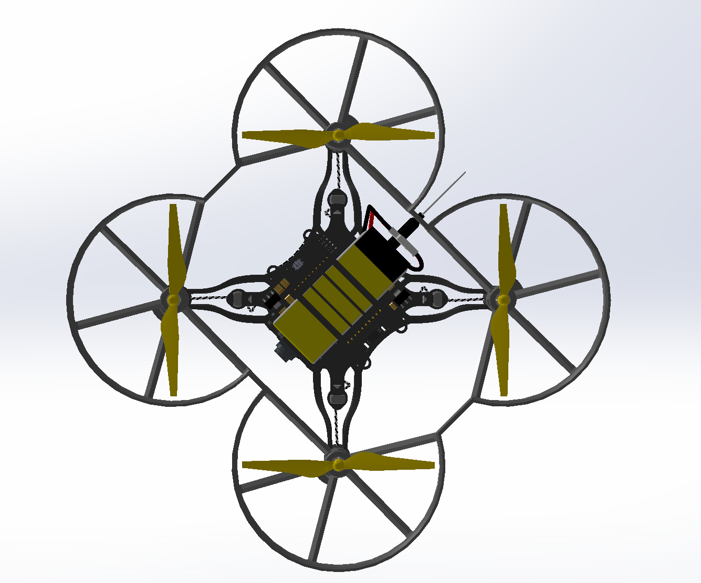 |
| 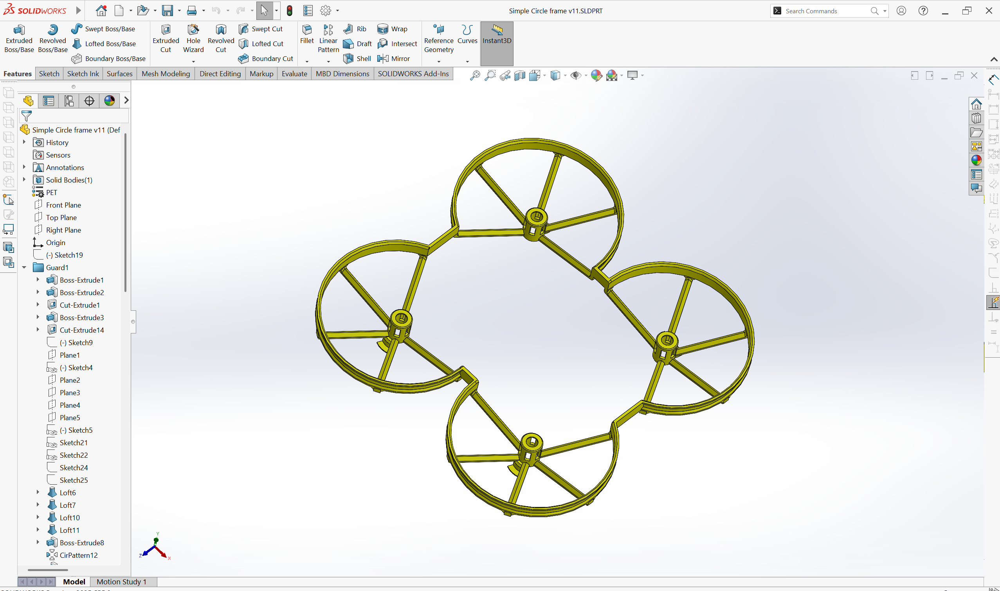 | 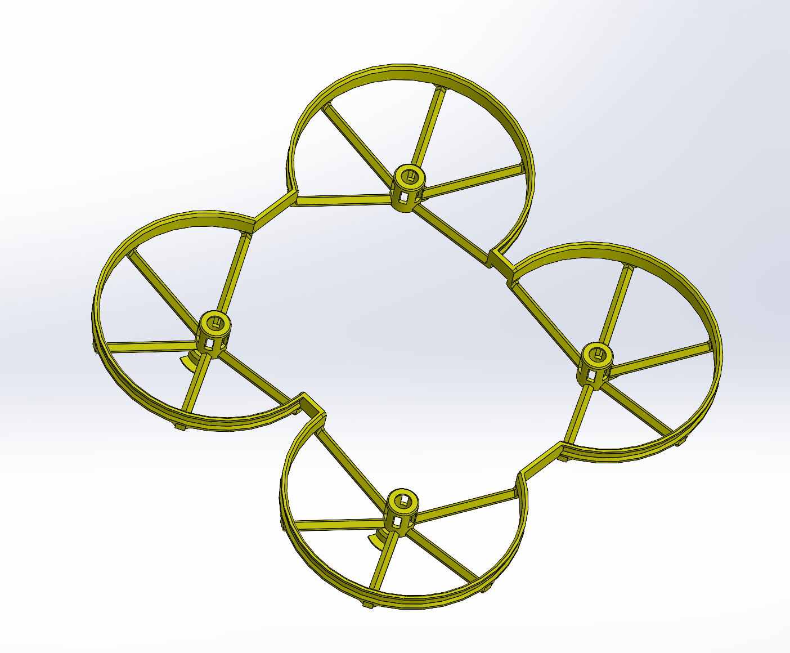 |
| 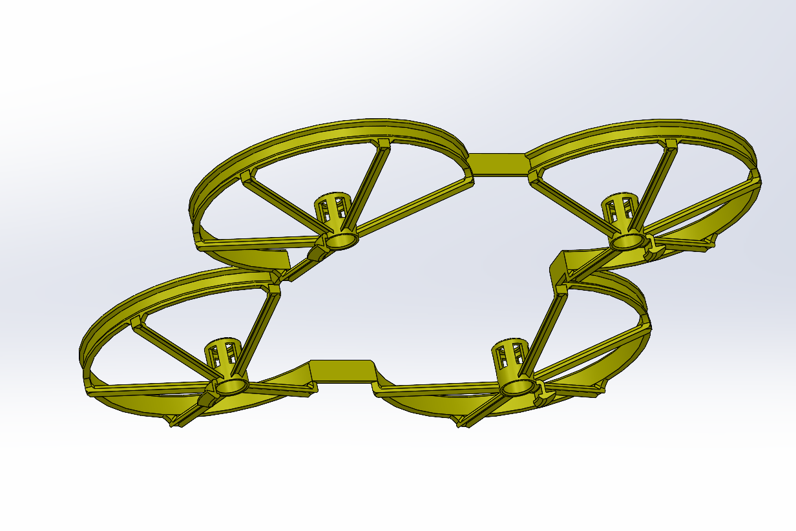 | |
